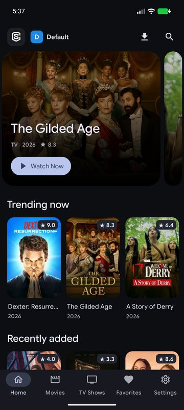
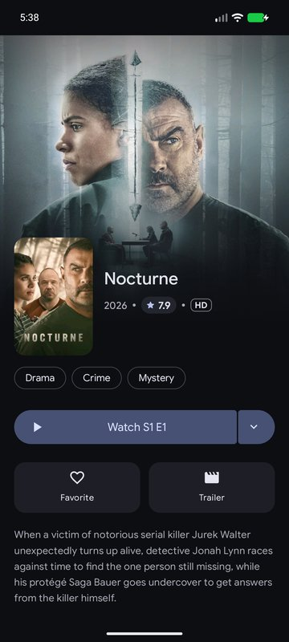
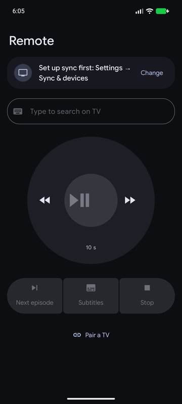
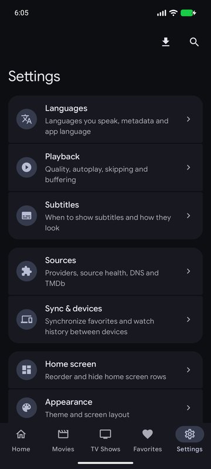
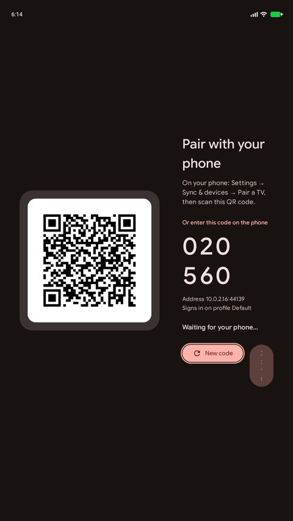

<h1 align="center">Streamable</h1>

<p align="center">
  
  <br />
  A redesigned, phone ↔ TV connected fork of <a href="https://git.gay/streamflix-reborn2/streamflix">Streamflix Reborn</a> for Android phones, tablets and Android TV.
  <br />
  <br />
  <a href="https://github.com/pwpp08/Streamable/releases/latest">
    <strong>⬇ Download the latest APK »</strong>
  </a>
</p>

<p align="center">
  
  
  
  
</p>

## What's different from Streamflix Reborn

### 🎨 Material 3 Expressive redesign
- Material Components 1.14 Expressive theme throughout, with the Google Sans Flex font and spring motion.
- Hero carousel and emphasized headers on the home screen, a split **Play | choose server** button on details pages, and grouped settings.
- Android TV: an expressive side rail, focus rings and cards that grow on focus. Phone: bottom navigation bar. Tablet: navigation rail.

### 📱↔📺 Phone and TV, connected
- **Shared library**: watchlist, watched episodes and Continue Watching sync between all your devices through Supabase, in realtime.
- **QR pairing**: the TV shows a QR code, you scan it with the phone, and the TV is signed in. Nothing to type with a remote.
- **Play on TV**: start something on the phone and it opens on the TV.
- **Phone as remote and keyboard**: play/pause, ±10 s, next episode, subtitles, and type searches on the TV from your phone.
- **Hand-off**: pick up on one device where you stopped on the other.

### ▶️ Smoother, more reliable playback
- **Your languages only**: choose the languages you speak (default English + Hungarian). Only those audio and subtitle tracks are loaded and shown.
- Servers are resolved in parallel and ranked 1080p-first. If one fails, playback switches to the next server at the same position.
- Device-aware buffering (low-memory profile for projectors and cheap TV boxes), retries before giving up, and progress saved every 15 s.
- **Skip intro / recap / credits** (TheIntroDB), with an Up Next countdown.
- Subtitle presets (Classic, Yellow, Outline, Large) and frame-rate matching on TV.
- Media3 1.11, R8-optimised release build (~20 MB).

### 🧹 Cleaner sources
- Only English sources are kept, and dead ones were removed after an automated health test.
- **Source health** screen (Settings → Sources): tests each source and shows whether it works, how fast it is and its best quality.

### 📥 More
- Offline downloads on phones.
- Customisable home rows (reorder or hide).
- Search history and suggestions.
- Continue Watching control: remove items, mark watched or unwatched.

## Install

1. Download `Streamable-<version>.apk` from the [latest release](https://github.com/pwpp08/Streamable/releases/latest).
2. Open it on your phone, tablet or Android TV and allow installing from unknown sources. On a TV, copy it over with a USB stick or send it with an app like *Send files to TV*.
3. One APK works everywhere: it opens the phone or TV interface automatically.

> **Coming from Streamflix?** Streamable uses the same package name but a different signing key, so Android won't install it over an existing Streamflix. Back up first (Settings → Backup), uninstall Streamflix, install Streamable, then restore.

Requires Android 6.0 or newer.

## Set up sync (once per person)

The app comes connected to a shared Supabase project, so there's nothing to configure:

1. On your phone: **Settings → Sync & devices**, then sign up with an e-mail and password. Everyone gets their own private library.
2. On the TV: **Settings → Sync & devices → Pair with phone**. A QR code appears.
3. On the phone: **Settings → Sync & devices → Pair a TV**, and scan the code (or type the 6-digit code shown).

Both devices must be on the same Wi-Fi network for pairing. After that, sync works anywhere.

<p align="center">
  
</p>

### Using your own Supabase project instead
1. Create a free project at [supabase.com](https://supabase.com).
2. Run [`app/src/main/res/raw/supabase_setup.sql`](app/src/main/res/raw/supabase_setup.sql) in its SQL Editor.
3. Turn off **Authentication → Sign In / Providers → Email → Confirm email**.
4. Put your URL and publishable key in the app (Settings → Sync & devices), or in `local.properties` before building (see below).

## Building

Requirements: JDK 17 and the Android SDK (AGP 8.13, Gradle 8.14).

```bash
./gradlew :app:assembleRelease
```

The APK is written to `app/build/outputs/apk/release/`. Optional overrides go in `local.properties`:

```properties
TMDB_API_KEY=your_tmdb_v3_key
SUPABASE_URL=https://your-project.supabase.co
SUPABASE_KEY=sb_publishable_...
APP_LAYOUT=tv   # or mobile; leave unset for automatic
```

Without them, the shared TMDB key and Supabase project built into `app/build.gradle` are used.

Tests: `./gradlew :app:testDebugUnitTest` (unit) and `./gradlew :app:connectedDebugAndroidTest` (on a device or emulator, includes a QR pairing loopback test).

## Legal disclaimer

**This application is for educational and personal use only.**

- Streamable does not host, store or distribute any copyrighted content.
- All content comes from third-party providers and websites.
- You are solely responsible for making sure you have the legal right to access any content.
- The developers do not endorse or encourage copyright infringement.
- Please support creators and use official streaming services where available.

## Credits

- **[Lory-Stan TANASI](https://github.com/stantanasi)**, creator of the original Streamflix.
- **[Streamflix Reborn](https://git.gay/streamflix-reborn2/streamflix)**, the community continuation this fork is based on.

## License

Licensed under the `Apache-2.0` License. See [LICENSE](LICENSE).

© 2022 Lory-Stan TANASI · © 2025 Streamflix Reborn · Streamable modifications © 2026.
